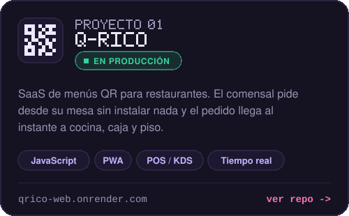
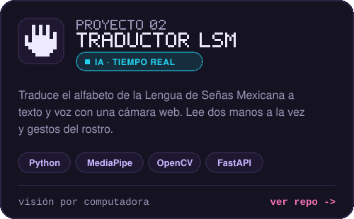
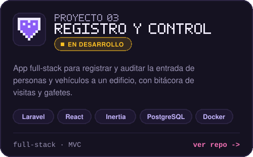
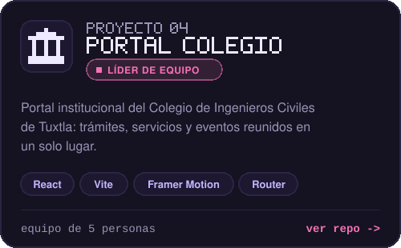

<!-- Arte y tarjetas: carpeta assets/ (se generan con generador/generar.py) -->

  

  
  
  

 

<!-- ─────────────────────────── SOBRE MÍ ─────────────────────────── -->

Soy estudiante de `Ingeniería en Sistemas Computacionales` en el **IESCH**, en Tuxtla Gutiérrez, Chiapas. Me gusta llevar los proyectos de clase más allá del aula: convertirlos en algo que la gente de verdad pueda usar.

Así nació **Q-RICO**, un `SaaS para restaurantes` que hoy está en producción, y un traductor de **Lengua de Señas Mexicana** que usa `visión por computadora` para que más personas puedan comunicarse. He liderado equipos de desarrollo, y disfruto tanto diseñar la arquitectura como cuidar cada detalle de la interfaz.

Hoy me enfoco en `Full-Stack` y `Computer Vision`, y busco unas **prácticas** donde pueda aprender a construir software a gran escala.

 

  

 

<!-- ─────────────────────────── STACK ─────────────────────────── -->

  

  
  
  
  
  
  
  

 

<!-- ─────────────────────────── PROYECTOS ─────────────────────────── -->

  
  

  
  

  

 

<!-- ─────────────────────────── ACTIVIDAD ─────────────────────────── -->

  

  
  

  

 

<!-- ─────────────────────────── CONTACTO ─────────────────────────── -->

  
  
  

 

  

