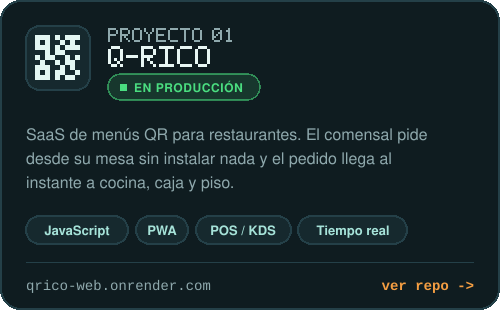
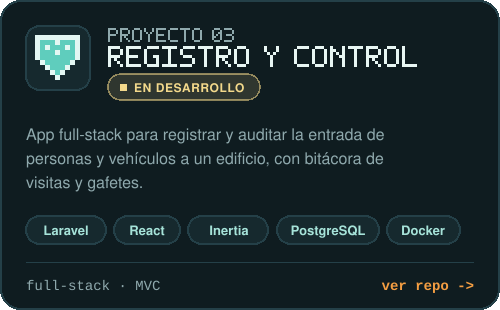

<!-- Arte y tarjetas: carpeta assets/ (se generan con generador/generar.py) -->

  

  
  
  

 

<!-- ─────────────────────────── SOBRE MÍ ─────────────────────────── -->

Soy **Desarrollador Frontend (React)** y estudiante de `Ingeniería en Sistemas Computacionales` en el **IESCH** (7.º semestre, promedio superior a 9.5), en Tuxtla Gutiérrez, Chiapas. Construyo interfaces claras, accesibles y pensadas para quien realmente las usa: desde un portal institucional con panel de administración hasta un SaaS para restaurantes en producción.

Mi base viene de la **programación estructurada y orientada a objetos con `C++`** y de la **lógica de negocio y datos en `Visual FoxPro`** (bases relacionales DBF), además de `PHP / Laravel`, `Python` y SQL (`MySQL`, `PostgreSQL`, `Supabase`). Esa mezcla me permite entender tanto la capa visual como el sistema que la sostiene.

 

  

 

<!-- ─────────────────────────── STACK ─────────────────────────── -->

  

  
  
  
  
  
  
  

 

<!-- ─────────────────────────── PROYECTOS ─────────────────────────── -->

  
  

  
  

  
  
  

<b>Qué construí en cada proyecto</b>

 

**Portal CICTGZ** · `React 19` · `Vite` · `React Router` · `Supabase`
- Arquitectura híbrida: contenido normativo en módulos locales y noticias, cursos y asambleas desde un panel `/admin` conectado a Supabase (PostgreSQL, Storage y Auth), con contenido de respaldo si no hay conexión.
- Sistema de diseño en CSS puro, alto contraste y tipografía de 18 px para un público adulto que navega desde el teléfono; carruseles táctiles con `scroll-snap`.
- Flujo de equipo con Pull Requests y verificación automática (lint, build y reglas del proyecto) en GitHub Actions.

**Q-RICO** · `JavaScript ES6+` · `PWA` · `Render`
- Menú QR para el comensal, panel con POS, monitor de cocina (KDS) y mapa de mesas, sincronizados en tiempo real con un store reactivo propio sobre `BroadcastChannel`.
- Sanitización de datos contra XSS, validación del estado y de sesión, y cabeceras de seguridad HTTP.
- Sin framework ni paso de compilación: HTML semántico, design tokens en CSS y APIs nativas del navegador.

**Traductor LSM** · `Python` · `MediaPipe` · `FastAPI` · `JavaScript`
- Reconoce el alfabeto de la Lengua de Señas Mexicana, frases con movimiento y gestos del rostro con una cámara web, y lo convierte en texto y voz.
- Motor portado a JavaScript para correr en el navegador (Vercel) como PWA instalable, con 0 diferencias frente al motor de Python en 3 976 fotogramas de prueba.

 

<!-- ─────────────────────────── ACTIVIDAD ─────────────────────────── -->

  

  
  

  

 

<!-- ─────────────────────────── CONTACTO ─────────────────────────── -->

  
  
  

  

 

  

